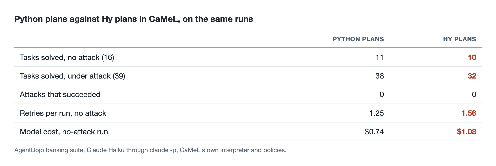
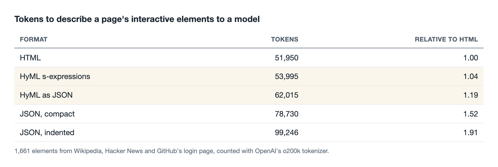
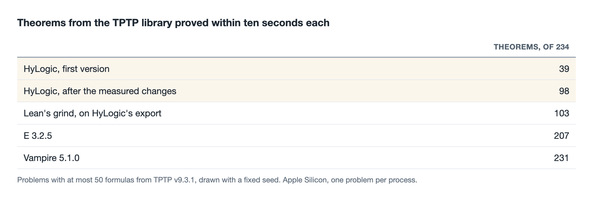
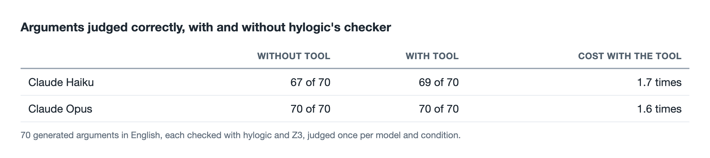

# Where a Lisp still fits next to AI agents

*I tested Hy, a Lisp that runs on Python, in three places where AI agents work. It lost in all three, and then found its place somewhere else.*


---

Same model, same tasks, same security system. When an AI agent wrote its plans in Python, it solved 38 of 39 banking tasks while under attack. When it wrote the same plans in Lisp, it solved 32.

The more interesting questions are why, and where a Lisp is still the right tool now that language models write so much of our code. This article collects five measurements on those questions. Three went against Lisp, one went for it, and the last one found where even a strict checker stops helping.

## Why ask at all

[Hy](https://hylang.org) is a dialect of Lisp that compiles to Python. Everything in Lisp is written as nested lists in parentheses, called s-expressions, so `(+ 1 2)` adds two numbers and `(send_money :recipient iban :amount 10)` calls a function with two named arguments. Because code and data have the same shape, a Lisp program can read, check and rewrite other programs as easily as it handles lists. That is why Lisp has long been the classic language for building small languages of one's own, domain-specific languages.

I have written two libraries in Hy. [HyML](https://github.com/markomanninen/hyml) writes HTML as s-expressions, and [hylogic](https://github.com/markomanninen/hylogic) handles logic. Both started in 2017, before AI agents. Coming back to them, I had to ask whether a Lisp notation still earns its place when a model can translate almost anything into anything.

The intuition in favour goes like this. Agents produce structured output all day, such as plans, tool calls and web pages. A uniform tree of parentheses is easy for a program to check, so perhaps it is also a good language for agents to write. I tested that intuition three ways.

## Result 1. Plans written in Lisp made the agent worse

The first test used [CaMeL](https://arxiv.org/abs/2503.18813), a defence against prompt injection from Google, Google DeepMind and ETH Zurich. Prompt injection means hiding instructions for an AI in data it reads, such as an email or a document, in the hope that the agent follows them. CaMeL stops it by design. A privileged model turns the user's request into a small program before reading any data. A separate interpreter runs the program and tracks where every value came from. Untrusted data is only ever read by a second, quarantined model that cannot call tools, and before each tool call a security policy checks the origin of the arguments. A transfer whose recipient came from a document the attacker could write is refused.

CaMeL's programs are written in a restricted subset of Python. Hy compiles to Python's own syntax tree, so a plan written in Hy can run on CaMeL's unchanged interpreter with CaMeL's unchanged policies. That made a clean experiment possible, where the only difference is the language the model writes. Here is the same plan in both.

```python
txs = get_most_recent_transactions(n=100)
print(sum([t.amount for t in txs
           if t.sender == "me" and t.date.startswith("2022-03")]))
```

```hy
(setv txs (get_most_recent_transactions :n 100))
(print (sum (lfor t txs
              :if (and (= t.sender "me") (.startswith t.date "2022-03"))
              t.amount)))
```

I ran both on the banking tasks of [AgentDojo](https://github.com/ethz-spylab/agentdojo), the benchmark CaMeL was evaluated on, with Claude Haiku as the model. AgentDojo checks each result automatically, for example whether the right amount went to the right account. In the attacked runs it hides a message in the agent's data asking it to send money to the attacker.



*Python plans against Hy plans in CaMeL, on the same AgentDojo banking runs with Claude Haiku.*

Counted run by run, Python solved eight that Hy failed, and Hy solved one that Python failed. That is a small sample, but the direction is clear (sign test, p ≈ 0.04).

The reasons were visible in the error messages. The model carried its Python and Clojure habits into Hy. It wrote `true` for `True`, `first` for the first element, `(print "=" * 50)` with an infix multiplication, and Python's escaped quotes inside a Hy f-string. Hy then made things worse by reporting the stray `*` as `hyx_XasteriskX`, its internal name, which the model had never written. Each mistake cost a retry, and each retry cost tokens. Hy replies were also longer, 1.8 times the output tokens of Python without attack.

Security was identical, and no attack succeeded in either condition. That protection comes from CaMeL's interpreter and policies, which were the same in both. The notation added nothing to it.

## Result 2. Parentheses save no tokens

The second hope was compactness. A model pays for every token it reads and writes, and Lisp needs no closing tags and few quotes.

In the field test for [my article on HyML](https://markotmanninen.substack.com/p/letting-ai-agents-write-html-without), agents wrote web pages through a tool, once as s-expressions and once as JSON. The s-expressions saved nothing. The markup travels to the tool inside a JSON string, so every quotation mark is escaped with a backslash, which eats the savings.

The other direction is input, meaning how a page is described to a model. The browser automation company Skyvern [measured](https://www.skyvern.com/blog/html-vs-json-llm-tokens-cost-reduction-success-rate/) that listing a page's buttons, links and fields as HTML takes 20 to 27 percent fewer tokens than JSON, and lowered their costs. I took the interactive elements of three real pages, the Wikipedia article on Lisp, the Hacker News front page and GitHub's login page, 1,661 elements in all, and counted the tokens in five formats.



*Tokens to describe the interactive elements of three web pages to a model.*

The closing parenthesis saves the closing tag, and the quotes around every text and value and the colon before every attribute name cost it back. HTML stays the most compact, and it is also the format models have seen most.

## Result 3. Safety came from the checker, not the syntax

The part of HyML that did work for agents is its safe data mode. The agent sends markup as data, and a strict checker rejects scripts, event handlers, unsafe addresses and unknown tags before any HTML is written. In my comparison of ten attacks it blocked 9 by default and all 10 with a list of allowed sites, where the most used Python sanitizer, nh3, blocked 8. In the field test no injection reached a page.

When an agent made a mistake, the checker told it exactly where, and the next attempt was correct. That loop of a small vocabulary, a strict checker and precise errors is what protected the page. It worked the same when the agent wrote JSON, which models write without effort.

CaMeL shows the same pattern at a larger scale. Its safety is a checker too, an interpreter and a set of policies that refuse what they cannot verify. In both cases the protection lives in the program that reads the output, so the output may as well be in the language the model knows best.

## Result 4. Where the parentheses pay off

So where does a Lisp still fit? In the parts that programs read and write, rather than the parts models write. To test that, I wrote a small automated theorem prover in Hy, the classic Lisp exercise, and then made it part of HyLogic.

Logic is a natural fit because formulas are trees. In Hy, a formula is simply quoted code, with the usual symbols.

```hy
'(∀ [x] (→ (Man x) (Mortal x)))
```

The program receives that as data and can take it apart, rewrite it and prove things about it without a parser. The prover does what classical provers do. It turns formulas into clauses, matches them with unification, and searches for a contradiction with resolution. It then prints the proof with each step's parents, here for the textbook puzzle of who killed the cat Tuna.

```
   8. (not (Kills curiosity tuna))                 negated goal
  10. (Kills jack tuna)                            resolve 5, 8
  13. (AnimalLover jack)                           resolve 12, 1
  16. (not (Animal tuna)) | (not (AnimalLover jack)) resolve 4, 10
  21. (not (AnimalLover jack))                     resolve 16, 9
  26. □                                            resolve 21, 13
```

Read from line 8. If Curiosity did not kill Tuna, Jack did. Jack owns a dog, so he loves animals, and animal lovers kill no animals. The empty clause □ marks the contradiction.

Macros are the other place a Lisp earns its keep. A rewrite rule such as "the derivative of a constant is zero" has to stay unevaluated text, and its condition has to become a function of the rule's variables. A function cannot see its arguments before they are evaluated, but a macro can.

```hy
(defrules DERIVATIVE
  (d ?x ?x)        -> 1
  (d ?x ?c)        -> 0  :if (free-of? ?c ?x)
  (d ?x (* ?u ?v)) -> (+ (* (d ?x ?u) ?v) (* ?u (d ?x ?v))))
```

The whole prover is about 400 lines. It proves the standard first test set for provers, Pelletier's problems 1 to 24, in milliseconds each, and problem 34, known as Andrews' challenge, in about five seconds after its clauses blow up to 1,296. The Z3 solver agreed on every problem, and on 300 random formulas the prover agrees with truth tables every time.

HyLogic 1.0 wraps this into a library with truth tables, models and arguments that are checked and explained.

```hy
(defargument modus-tollens
  :premises [(→ P Q) (¬ Q)]
  :conclusion (¬ P)
  :meanings {P "It rains" Q "The street is wet"})
```

```
  P → Q
  ¬Q
  ───────
∴ ¬P

  P: It rains
  Q: The street is wet

Valid, by truth table.
```

An invalid argument gets a counterexample instead, such as "P = ⊥, Q = ⊤" for concluding that it rains because the street is wet. None of this would be impossible in Python, but in Hy the formulas, the rules and the code are one notation, and the program stays short enough to read in an evening.

How far does a prover that is meant to be read get against the real ones? I measured it on 234 theorems from TPTP, the standard problem library for provers, with ten seconds for each, next to E and Vampire, two of the strongest automated provers. The first version proved 39. After ten measured changes, among them ordered resolution, superposition for reasoning about equality and a search that stays close to the goal, it proves 98.



*Theorems from the TPTP library proved within ten seconds each.*

The rest of the distance is decades of tuned search strategy, which a study prover has no reason to copy. Doubling the time limit added a single theorem, so speed was not what held it back. HyLogic can instead hand a problem to Vampire, read the proof it prints and show it in the same numbered form, which worked for all 440 proofs E and Vampire produced, and it can write any problem as a Lean theorem for the cases that need real mathematics. The benchmark also paid for itself in another way. It caught a soundness bug, a valid theorem reported as unprovable because the prover's choice of literal depended on variable names, which no test of mine had found.

## Result 5. A logic checker added cost, not accuracy

The last test turned the question around. If strict checking is what protects agents, perhaps agents also reason better with a checker at hand, in a domain where formulas are the natural notation. HyLogic got an MCP tool, `check_argument`. The agent writes the premises and the conclusion as formulas, and the tool decides whether the argument is valid and returns a counterexample when it is not.

To measure it, I generated 70 arguments in everyday English, each checked by both HyLogic and Z3. A valid argument needs every one of its premises. An invalid one is tempting, because its conclusion holds in most of the situations the premises allow. The wording includes "only if" and "unless", which people often get wrong, and eight syllogisms test belief bias, such as "All roses are flowers. Some flowers fade quickly. Therefore, some roses fade quickly", which sounds right and does not follow. Each argument went once to each model, with and without the tool.



*70 generated arguments, each judged once per model, with and without HyLogic's checker.*

The models were far better than I expected. Haiku alone got 96 percent right, Opus everything, and neither fell for a single belief-bias syllogism. The tool raised Haiku by two arguments, which is within the variation between runs, and made every answer more expensive.

The errors that remained tell more than the totals. Every argument Haiku got wrong, with or without the tool, contained a sentence of the form "Unless A, B". With the tool its formalizations show what went wrong. Haiku wrote that sentence as "not A or B", although the prompt said that "unless" means "or", and HyLogic then confirmed the misread argument exactly as written. A checker can only check what it is given, and at this size the hard part was reading the English, not the reasoning.

The field test also tested the tool. Twice Haiku sent a formula in a shape I had not planned for, once as a quoted string inside a string and once as a list with a single item, and the tool misread both. The call logs showed it, the fixes took a few lines, and the results above come from runs with the fixed tool. An agent is a tool's most demanding first user.

## What I take from this

1. **Let models write the languages they know.** A less familiar notation costs retries and tokens, even when it is simpler on paper.
2. **Put safety in a checker with a small vocabulary.** The protection came from the program reading the output, in both HyML and CaMeL, and not from the format of the output.
3. **Measure tokens instead of guessing.** Parentheses looked compact and were not, in either direction.
4. **Use Lisp where programs handle the code.** Provers, rewriters and compilers read and transform trees, and there code as data and macros pay off.
5. **Make the errors readable for the writer.** An agent fixed a precise error in one step and stumbled on a mangled one.
6. **A checker only checks what it is given.** When the hard part is understanding the question, a tool for the reasoning adds cost and little else.
7. **Test tools with agents before trusting them.** The field test found two bugs in my own tool that my tests had not.

## Limits, and trying it yourself

The CaMeL test used one model, Claude Haiku, and one of AgentDojo's four suites. I stopped the attacked runs at 39 of 144 task pairs to limit model calls, and those 39 came from the tasks that finished first, so they are not a random sample. A stronger model may close part of the gap. The token counts use OpenAI's tokenizers, because Claude's is not available offline, and pages change over time. The logic field test gave each argument once to each model, and its arguments are generated, short and propositional apart from the syllogisms, so a checker may still pay off on longer first-order reasoning. The prover is a study tool, and the TPTP sample is 234 theorems of at most 50 formulas, a small corner of what E and Vampire are built for. For serious mathematics [Lean](https://lean-lang.org) is where the work happens.

Everything is on GitHub. The CaMeL experiment, its hypotheses written before the runs, and the token measurement are in the [hyml repository](https://github.com/markomanninen/hyml/tree/camel-plan-language/experiments). The logic field test, its arguments and its hypotheses are in [hylogic's benchmarks](https://github.com/markomanninen/hylogic/tree/master/benchmarks), next to a comparison of truth tables, resolution, a SAT solver and Z3. HyLogic installs with `pip install hylogic`, and `hy examples/tour.hy` walks through truth tables, arguments, rewriting and proofs, with a step-by-step guide to how the prover works.

GitHub: [hylogic](https://github.com/markomanninen/hylogic) · [hyml](https://github.com/markomanninen/hyml)

## Sources

- Debenedetti et al., [Defeating Prompt Injections by Design](https://arxiv.org/abs/2503.18813) (CaMeL), and its [code](https://github.com/google-research/camel-prompt-injection).
- [AgentDojo](https://github.com/ethz-spylab/agentdojo), the benchmark for prompt injection against agents.
- Skyvern, [HTML vs JSON for LLM tokens](https://www.skyvern.com/blog/html-vs-json-llm-tokens-cost-reduction-success-rate/).
- [Letting AI agents write HTML without trusting them](https://markotmanninen.substack.com/p/letting-ai-agents-write-html-without), the HyML field test and security comparison.
- F. J. Pelletier, [Seventy-five problems for testing automatic theorem provers](https://doi.org/10.1007/BF02432151), Journal of Automated Reasoning, 1986.
- J. A. Robinson, A Machine-Oriented Logic Based on the Resolution Principle, Journal of the ACM, 1965.
- [Z3](https://github.com/Z3Prover/z3), the solver used to check the problems.
